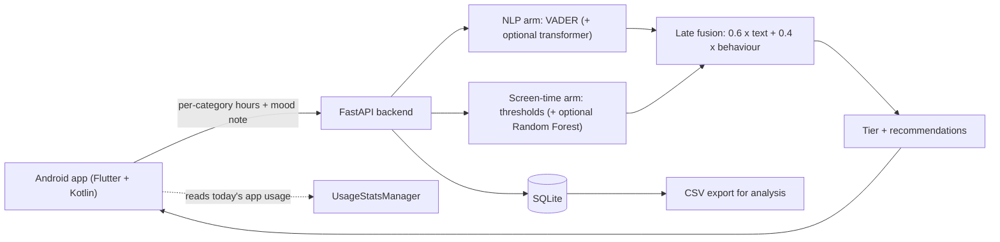

# NLP-Augmented Personalized Digital Wellbeing

A native Android app and Python backend that combine **objective screen-time data** (read from the phone) with an **NLP score from a short daily mood note** to produce a personalised wellbeing recommendation for college students. Built as an MCA Semester III capstone research project at TIMSCDR (University of Mumbai).

> **This is a research prototype and a self-awareness aid. It is not a diagnostic tool and not a substitute for professional help.**

---

## Table of contents

1. [Features](#features)
2. [How it works](#how-it-works)
3. [Tech stack](#tech-stack)
4. [Repository structure](#repository-structure)
5. [Prerequisites](#prerequisites)
6. [Setup](#setup)
   - [1. Get the code](#1-get-the-code)
   - [2. Run the backend](#2-run-the-backend)
   - [3. Generate the Android app](#3-generate-the-android-app)
   - [4. Open it in Android Studio](#4-open-it-in-android-studio)
7. [Running the app on the emulator](#running-the-app-on-the-emulator)
8. [Using the app: step-by-step walkthrough](#using-the-app-step-by-step-walkthrough)
9. [Running on a real phone](#running-on-a-real-phone)
10. [Building an APK](#building-an-apk)
11. [Configuration](#configuration)
12. [API reference](#api-reference)
13. [Research workflow (from pilot data to results)](#research-workflow-from-pilot-data-to-results)
14. [Testing](#testing)
15. [Troubleshooting](#troubleshooting)
16. [Known limitations](#known-limitations)
17. [Ethics, privacy and safety](#ethics-privacy-and-safety)
18. [Acknowledgements](#acknowledgements)
19. [License](#license)

---

## Features

- **Automatic screen-time capture** via Android's `UsageStatsManager`, grouped into six categories: Social Media, Entertainment, Gaming, Productivity, Education, Other.
- **Daily mood note** (free text) scored for sentiment with VADER; an optional fine-tuned transformer can replace the placeholder risk proxy.
- **Category-wise thresholds** (2 h social media, 3 h entertainment, 2 h gaming, 6 h productivity, 4 h education, 2 h other, 8 h total) with an optional trained Random Forest.
- **Late fusion** of the text signal and the behaviour signal into one 0–1 score and a `low / moderate / high` tier.
- **Personalised, tiered recommendations**, plus a crisis-language safety net that shows helpline information.
- **In-app questionnaires** for study validation: PHQ-9, GAD-7 and PSS-10, with standard scoring.
- **Dashboard**: today's usage vs. thresholds, 7-day score chart and history.
- **Research export** to CSV (pseudonymous user IDs) and training scripts for the models.

## How it works



1. The app reads today's foreground time per app, maps each app to one of six categories using an on-device lookup table, and sends **only category totals** (not app names) to the server.
2. The student writes a short note about their day.
3. The backend scores the text and the screen-time pattern, fuses them (weights are configurable) and returns a tier with recommendations.
4. Periodically the student completes PHQ-9 / GAD-7 / PSS-10. These are used by the researcher to validate and calibrate the model, not to make a diagnosis.

## Tech stack

| Layer | Technology |
|---|---|
| Mobile app | Flutter (Dart) with a Kotlin platform channel for `UsageStatsManager` |
| Backend | Python 3.10+, FastAPI, Uvicorn |
| NLP | VADER (`vaderSentiment`); optional Hugging Face transformer you fine-tune yourself |
| ML | scikit-learn (Random Forest), pandas, NumPy, joblib |
| Storage | SQLite (standard library) |
| Auth | PBKDF2-SHA256 password hashing, hashed bearer session tokens |
| Tests | pytest, httpx |

## Repository structure

```
.
├── backend/
│   ├── app/                  FastAPI application
│   │   ├── main.py           API endpoints
│   │   ├── config.py         thresholds, weights, tier cut-offs, helplines
│   │   ├── nlp_engine.py     VADER + optional transformer
│   │   ├── screen_engine.py  thresholds + optional Random Forest
│   │   ├── fusion.py         late fusion and tiers
│   │   ├── recommend.py      tiered recommendations
│   │   ├── safety.py         crisis-language check
│   │   ├── assessments.py    PHQ-9 / GAD-7 / PSS-10 scoring
│   │   ├── db.py, security.py
│   ├── data/instruments.json questionnaire items
│   ├── scripts/              training and data scripts
│   ├── tests/                pytest suite
│   └── requirements.txt
├── flutter_app/
│   ├── setup.py              generates the Flutter project and applies the overlay
│   └── overlay/              Dart sources + MainActivity.kt.template
└── README.md
```

`flutter_app/app/` (the generated Flutter project) is created by `setup.py` and is git-ignored.

## Prerequisites

| Tool | Notes |
|---|---|
| **Python 3.10 or newer** | `python --version` |
| **Flutter SDK (stable)** | `flutter doctor` must show no issues for *Android toolchain* |
| **Android Studio** | with the Flutter and Dart plugins, an Android SDK and an emulator (AVD) |
| **Git** | to clone the repository |

Setup was developed against Windows 11 with PowerShell; macOS and Linux commands are given where they differ.

---

## Setup

### 1. Get the code

```bash
git clone <your-repository-url>
cd digital-wellbeing
```

### 2. Run the backend

**Windows (PowerShell)**

```powershell
cd backend
python -m venv .venv
.\.venv\Scripts\Activate.ps1
pip install -r requirements.txt
```

If PowerShell refuses to run the activation script ("running scripts is disabled"), run this once in the same window and activate again:

```powershell
Set-ExecutionPolicy -Scope Process -ExecutionPolicy Bypass
```

**macOS / Linux**

```bash
cd backend
python3 -m venv .venv
source .venv/bin/activate
pip install -r requirements.txt
```

Start the server (keep this terminal open for as long as you use the app):

```powershell
# optional: enables the /admin export endpoints (PowerShell)
$env:ADMIN_TOKEN = "choose-a-long-random-secret"
# macOS/Linux: export ADMIN_TOKEN="choose-a-long-random-secret"

uvicorn app.main:app --host 0.0.0.0 --port 8000
```

You should see `Application startup complete` and `Uvicorn running on http://0.0.0.0:8000`.

Check it is working:

- <http://localhost:8000/health> returns `{"status":"ok", ...}`
- <http://localhost:8000/docs> shows the interactive API documentation

A `wellbeing.db` SQLite file is created in `backend/` on first start.

### 3. Generate the Android app

Open a **second** terminal (the backend keeps running in the first):

```bash
cd flutter_app
python setup.py          # on Windows you can also use: py setup.py
```

`setup.py` will:

1. run `flutter create` to generate the Android project in `flutter_app/app`,
2. add the `http` and `shared_preferences` packages,
3. copy the app's Dart sources into `app/lib`,
4. replace `MainActivity.kt` with the `UsageStatsManager` bridge (using the generated package name),
5. add the `INTERNET` and `PACKAGE_USAGE_STATS` permissions and allow cleartext HTTP in `AndroidManifest.xml`.

If it reports that `app` already exists, delete `flutter_app/app` and run it again.

### 4. Open it in Android Studio

1. **File → Open** and choose **`flutter_app/app`** (the folder that contains `pubspec.yaml`), *not* the repository root. Opening the root will show "No run configurations" because Android Studio will not recognise it as a Flutter project.
2. Wait for indexing and `pub get` to finish. A `main.dart` run configuration appears automatically.

---

## Running the app on the emulator

1. **Create an emulator** (first time only): *Tools → Device Manager → Create Device*, pick a Pixel phone and a **stable** system image, then finish.
2. **Start the emulator** from Device Manager and wait until the Android home screen is visible.
3. **Confirm Flutter can see it.** In a terminal inside `flutter_app/app`:

   ```bash
   flutter devices
   ```

   You should see an `emulator-5554` (or similar) entry.
4. **Run the app** either with the green **Run** button in Android Studio (select the emulator in the device dropdown first) or from the terminal:

   ```bash
   flutter run
   ```

   The first build takes several minutes. Later runs are much faster, and `r` in the terminal hot-reloads code changes.

---

## Using the app: step-by-step walkthrough

Start with the backend running and the app launched on the emulator.

### Step 1: Point the app at the backend

On the **Sign in** screen set **Server address** to:

```
http://10.0.2.2:8000
```

`10.0.2.2` is the emulator's alias for the computer it runs on. (For a real phone see [Running on a real phone](#running-on-a-real-phone).)

### Step 2: Create an account

1. Tap **Create an account**.
2. Enter a username (3–32 characters: letters, digits, `_ . -`) and a password (at least 8 characters).
3. Optionally choose age group, gender and residence.
4. Read the consent text and tick the checkbox. **Create account** stays disabled until you do.
5. Tap **Create account**. You are signed in and taken to the home screen.

### Step 3: Grant Usage Access

Android does not show a normal pop-up for this permission, so the app explains it and sends you to Settings.

1. On the **Allow Usage Access** screen tap **Open Settings**.
2. Find this app in the list (`digital_wellbeing`) and switch **Permit usage access** on. (The exact menu wording varies by Android version: *Settings → Apps → Special app access → Usage access*.)
3. Press **Back** to return to the app. It re-checks automatically; if it does not, tap **I've turned it on**.

### Step 3b: Generate some usage (emulator only)

An emulator has almost no real app usage, so the first numbers will be near zero. Open **Chrome** and **YouTube** (or any apps) for a few minutes, then return to the app and **pull down to refresh**. Apps that are not in the category list appear under **Apps counted under "Other"**, which is useful for extending the category map.

### Step 4: Submit a daily check-in

1. On the **Check-in** tab you will see today's screen time per category as bars against each threshold (bars turn red when a threshold is exceeded).
2. Write a few sentences about how your day felt (**at least 4 words**).
3. Tap **Submit check-in**.
4. The result card shows the **tier** (low / moderate / high), the combined score, the two underlying signals with their source, and recommendations. If the note contains crisis language, support information is shown instead of a routine tip.

You can submit again later the same day; the latest submission replaces the earlier one.

### Step 5: Review your history

Open the **History** tab for the last seven combined scores (colour-coded by tier) and a list of past check-ins. Pull down to refresh.

### Step 6: Complete a questionnaire

1. Open the **Questionnaires** tab and choose **PHQ-9**, **GAD-7** or **PSS-10**.
2. Answer every question (the **Submit** button enables once all are answered).
3. After submitting you see your score and band. If PHQ-9 item 9 is answered above "Not at all", support information and the helpline are shown.

### Step 7: Sign out

Use the sign-out icon in the top-right of the app bar.

---

## Running on a real phone

A real phone gives meaningful screen-time numbers.

1. Enable **Developer options** and **USB debugging** on the phone and connect it with a USB cable. Accept the debugging prompt on the phone.
2. Confirm with `flutter devices`, then run `flutter run` and select the phone.
3. Connect the phone and the computer to the **same Wi-Fi network**.
4. Find the computer's IP address (`ipconfig` on Windows, look for the IPv4 address, e.g. `192.168.1.10`).
5. In the app, set **Server address** to `http://<that-ip>:8000`.
6. If the phone cannot connect, allow Python through Windows Defender Firewall on *Private networks* (Windows usually asks the first time the server starts).

## Building an APK

For sharing with pilot participants:

```bash
cd flutter_app/app
flutter build apk --release
```

The APK is written to `build/app/outputs/flutter-apk/app-release.apk`. Participants must allow installing from unknown sources for that file. For anything beyond a small LAN pilot, host the backend behind **HTTPS** and remove `android:usesCleartextTraffic="true"` from the manifest.

---

## Configuration

Set these environment variables before starting the backend. Defaults are in `backend/app/config.py`.

| Variable | Default | Purpose |
|---|---|---|
| `ADMIN_TOKEN` | *(empty)* | Enables `/admin/*` exports when set; sent as the `X-Admin-Token` header |
| `WELLBEING_DB` | `backend/wellbeing.db` | SQLite database path |
| `W_TEXT`, `W_BEHAVIOR` | `0.6`, `0.4` | Fusion weights (normalised to sum to 1) |
| `TIER_MODERATE`, `TIER_HIGH` | `0.35`, `0.60` | Score cut-offs for the tiers. **Placeholders**; calibrate against PHQ-9/GAD-7/PSS |
| `SCREEN_MODEL_PATH` | `backend/data/screen_rf.joblib` | Trained Random Forest, used automatically if the file exists |
| `TRANSFORMER_MODEL_DIR` | *(empty)* | Directory of a fine-tuned sequence-classification model; unset means VADER proxy only |
| `TRANSFORMER_RISK_LABEL_INDEX` | `1` | Output index of the "at risk" class in that model |

Thresholds, category labels and helplines are defined in `config.py` and served to the app through `GET /config`, so the server is the single source of truth.

## API reference

| Method and path | Auth | Description |
|---|---|---|
| `GET /health` | none | Service status |
| `GET /config` | none | Thresholds, labels, minimum words, helplines, disclaimer |
| `POST /auth/register` | none | Create an account (`consent` must be `true`); returns a bearer token |
| `POST /auth/login` | none | Returns a bearer token |
| `POST /checkin` | Bearer | Body: `{day, hours{6 categories}, mood_text}`; returns scores, tier, recommendations |
| `GET /history?days=30` | Bearer | The user's past check-ins |
| `GET /assessments` | Bearer | List questionnaires |
| `GET /assessments/{phq9\|gad7\|pss10}` | Bearer | Questionnaire items and options |
| `POST /assessments/{name}` | Bearer | Body: `{answers: [int]}`; returns total, band and any support message |
| `GET /admin/export/checkins.csv` | `X-Admin-Token` | Research export; add `?include_text=true` to include mood text |
| `GET /admin/export/assessments.csv` | `X-Admin-Token` | Questionnaire export |

Full interactive documentation is available at `/docs` while the server runs.

## Research workflow (from pilot data to results)

1. **Collect** data from participants, then export it:

   ```bash
   curl -H "X-Admin-Token: <token>" "http://localhost:8000/admin/export/checkins.csv?include_text=true" -o checkins.csv
   curl -H "X-Admin-Token: <token>" http://localhost:8000/admin/export/assessments.csv -o assessments.csv
   ```
2. **Define the label.** Decide what "at risk" means (for example PHQ-9 ≥ 10 in the same period) and prepare a CSV with the six hour columns plus a `label` column (0/1).
3. **Train the behaviour model** (50 trees, `random_state=42`, 70/30 split):

   ```bash
   cd backend
   python scripts/train_screen_model.py your_labelled.csv
   ```

   The model is saved to `data/screen_rf.joblib` and loaded automatically on the next server start.
4. **Train the text model** (optional, requires `pip install transformers torch`, a GPU is recommended, and a labelled text dataset whose licence you have checked):

   ```bash
   python scripts/finetune_text_model.py labelled_text.csv --base distilbert-base-uncased --out data/text_model
   export TRANSFORMER_MODEL_DIR=data/text_model     # PowerShell: $env:TRANSFORMER_MODEL_DIR="data/text_model"
   ```
5. **Calibrate** `W_TEXT`, `W_BEHAVIOR`, `TIER_MODERATE` and `TIER_HIGH` against the questionnaire scores.
6. **Evaluate** text-only vs. screen-time-only vs. fused models against PHQ-9 / GAD-7 / PSS-10. This comparison is the main empirical result of the study.

`scripts/make_synthetic_data.py` generates **synthetic** data purely to test that the training pipeline runs. Never report results from it.

## Testing

Backend (from `backend/` with the virtual environment active):

```bash
pytest -q
```

The suite covers thresholds, fusion, tiering, the safety net, questionnaire scoring, the Random Forest loading path, authentication, check-in validation and CSV export. The Android app has no automated tests; use the walkthrough above to verify it manually.

## Troubleshooting

| Problem | Fix |
|---|---|
| **"No run configurations" in Android Studio** | You opened the repository root. Open `flutter_app/app` instead. |
| **`flutter run`: "No supported devices connected"** | Start the emulator first and wait for the home screen, then run `flutter devices`. If it is still missing, restart ADB (`adb kill-server`, `adb start-server`) or create an emulator with a stable system image. |
| **`flutter` is not recognised** | Add Flutter's `bin` folder to your `PATH` and restart the terminal and Android Studio. |
| **PowerShell blocks `Activate.ps1`** | `Set-ExecutionPolicy -Scope Process -ExecutionPolicy Bypass`, then activate again. |
| **App says "Could not reach the server"** | Check the backend terminal is still running; on the emulator use `http://10.0.2.2:8000`; on a phone use the PC's LAN IP, the same Wi-Fi, and allow Python through the firewall. `http://localhost:8000/health` must work in a browser on the PC. |
| **Usage bars stay at 0** | Usage Access is not granted, or the emulator has little usage. Grant it in Settings and open some apps for a few minutes, then pull down to refresh. |
| **Port 8000 already in use** | Run on another port (`--port 8001`) and change the address in the app. |
| **`setup.py` says `app` already exists** | Delete `flutter_app/app` and run it again. |
| **Build error after `setup.py`** | Copy the full error from the Run or Terminal panel and open an issue; include the Flutter version from `flutter --version`. |

## Known limitations

- **Android only.** Apple does not allow a general third-party app to read other apps' usage on iOS.
- **Screen-time accuracy is unvalidated.** Values come from Android usage events and are approximate; compare them with the phone's own Digital Wellbeing screen on a pilot device. Some manufacturers' Android builds behave differently.
- **The app-to-category map is a starter list.** Package ids should be verified against the Play Store; unmapped apps are counted as "Other". The check-in screen lists the heaviest unmapped apps to help extend it.
- **Without a trained model, the text "risk" is a placeholder**: `(1 − VADER compound) / 2`. It is a sentiment proxy, not a validated measure of depression or anxiety.
- **MentalBERT checkpoints are not used directly.** They are gated masked-language models without a classification head; a transformer is used only after you fine-tune one (`scripts/finetune_text_model.py`, which has not been run in an automated environment). Check each model's licence.
- **Tier cut-offs and fusion weights are initial values** until calibrated on pilot data.
- The crisis-language check is keyword-based and English-only; it can miss indirect wording and flag negations.
- Not implemented: admin web interface, login rate-limiting, password reset, push reminders, iOS support.

## Ethics, privacy and safety

- This is a **research study tool**. Obtain approval from your institution's ethics process before recruiting participants, and replace the draft consent text in `flutter_app/overlay/lib/screens/auth_screen.dart` with the approved wording.
- The app sends **per-category screen-time totals** and the **mood note**; it does not send which apps or content were used. Mood text is sensitive: restrict access to the database and exports, and never commit `*.db`, exported CSV files or real participant data to this repository.
- Agree a **referral process** with your guide or the college counselling cell before the pilot. The in-app helpline text (Tele-MANAS: 14416 / 1-800-891-4416) is a safety net, not a referral pathway; verify the numbers before deployment.
- Questionnaire licences: PHQ-9 and GAD-7 materials carry the notices of their developers (PHQ-9 sheets show a Pfizer copyright notice); the PSS page at Carnegie Mellon directs permission requests to MAPI Research Trust. Confirm your permission status before deployment.
- The app allows plain HTTP so a local pilot works. Use HTTPS for any wider deployment.

## Acknowledgements

- **Author:** Jyoti Jayant, MCA Semester III, TIMSCDR, University of Mumbai
- **Guide:** Prof. Rashmi Vipat
- Instruments: PHQ-9 and GAD-7 (Spitzer, Williams, Kroenke and colleagues); Perceived Stress Scale (Cohen, Kamarck and Mermelstein, 1983)
- Sentiment analysis: VADER (Hutto and Gilbert, 2014)

## License

No license file is included yet. Add one (for example MIT) before making the repository public, and check that it is compatible with any datasets or models you use.

<!--
Screenshots: add your own images to docs/screenshots/ and uncomment this block.

## Screenshots

| Sign in | Usage access | Check-in | Result | History | Questionnaire |
|---|---|---|---|---|---|
|  |  |  |  |  |  |
-->
